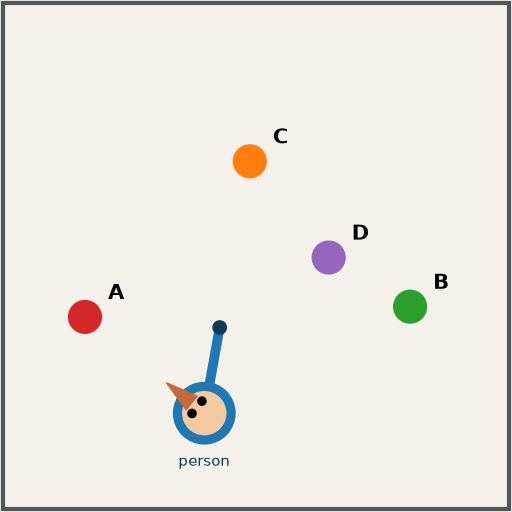

# Look here, point there: which cue do vision-language models follow for "bring me that one"?

People refer to objects with gaze and pointing together. When the two disagree (looking at one object while pointing
at another), which one does an AI assistant follow? And can it follow gaze at all? This pilot is a follow-up to
[that-one-pointing-vlm](https://github.com/zeeshanali66/that-one-pointing-vlm), which found that VLMs pick the object
**nearest the hand** rather than following the pointing direction.



## Design
- **40 generated top-down scenes**, each with 4 objects. The head (nose and eyes) faces object G; the arm points at
  object P. G and P are always at least 50 degrees apart, and the other objects are at least 25 degrees from both
  directions. **Distances are balanced**: in half the scenes P is nearer, in the other half G is.
- **Cue conditions**:
  - `congruent`: head and arm both toward P.
  - `conflict`: head toward G, arm toward P.
  - `gaze_only`: no arm.
  - `point_only`: the head faces an empty direction.
- **Requests**: "Bring me that one" (ambiguous), "the one I am looking at", "the one I am pointing at".
- **Models**: Gemma 4 12B, Qwen 3.5 9B and Gemma 3 12B (local, Ollama, temperature 0). The legend in the prompt
  explains the nose, eyes and arm. 960 answers, 0 invalid. A self-test checks that each cue picks out exactly one
  object and that distances are balanced.

## Results (chance = 0.25)
| model | gaze only, "looking at" | point only, "pointing at" | conflict, "looking at" | conflict, "pointing at" |
|---|---|---|---|---|
| Gemma 4 12B | 0.25 [0.12, 0.40] | 0.62 [0.47, 0.78] | 0.12 [0.03, 0.23] | 0.68 [0.53, 0.82] |
| Qwen 3.5 9B | 0.12 [0.03, 0.25] | 0.23 [0.10, 0.35] | 0.30 [0.17, 0.45] | 0.28 [0.15, 0.42] |
| Gemma 3 12B | 0.12 [0.03, 0.23] | 0.45 [0.30, 0.60] | 0.07 [0.00, 0.17] | 0.45 [0.30, 0.60] |

1. **No model can read gaze.** Even when gaze is the only cue and the user says "the one I am looking at", accuracy
   is at or below chance (0.12 to 0.25), even though the prompt explains what the nose and eyes mean.
2. **Pointing is read partly, and only by the stronger models** (Gemma 4: 0.62 to 0.68; Qwen 3.5: chance).
3. **Asked about gaze during a conflict, models follow the arm instead.** Gemma 4 picks the pointed object 0.30 of
   the time and the looked-at object 0.12.
4. **"That one" under conflict depends on distance, not on the cue.** Gemma 4 picks the pointed object 80% of the
   time when it is the nearer one, and 20% when it is the farther one. Once again, proximity drives the choice,
   matching the pointing study.

## What this means
An assistant that is shown a scene cannot be trusted to resolve "that one" from gaze or gestures. As in our other
studies, the fix is to **give the model the cue as geometry**: compute the gaze ray from a headset's eye tracker or
the pointing ray from a body tracker, and pass the resulting candidate object, not the pixels.

## Limitations
Top-down drawings (a top-down head is a weak gaze cue, even though it is explained in the prompt); 40 scenes; three
models; no human baseline yet (the same items can be added to the survey in
[spatial-human-baseline](https://github.com/zeeshanali66/spatial-human-baseline)). First-person views, where gaze is
naturally visible, are the next step.

## Run
```
python gaze_study.py selftest | render | run | results
```
`run_all.sh` adds the GPU heat watchdog. Tables: [`results/RESULTS.md`](results/RESULTS.md). Log:
[`docs/RESEARCH_LOG.md`](docs/RESEARCH_LOG.md).

## Disclosure
Code and documentation were written with the help of an AI assistant; the research design, checking and decisions
are the author's.

## License
MIT
